# Proposal screenshots (contact sheet)

Made by `tool/screenshots/run.mjs` on the emulator bundle with the trial seed
(2026-11-20), Indonesian, light, 1280 × 800.

## 01_login_register.png

Register form with the placement choice

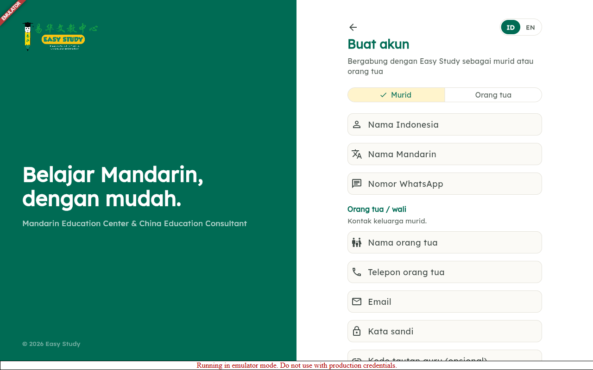

## 02_sesi_kelas.png

Student home: Sesi Kelas with seats and Daftar

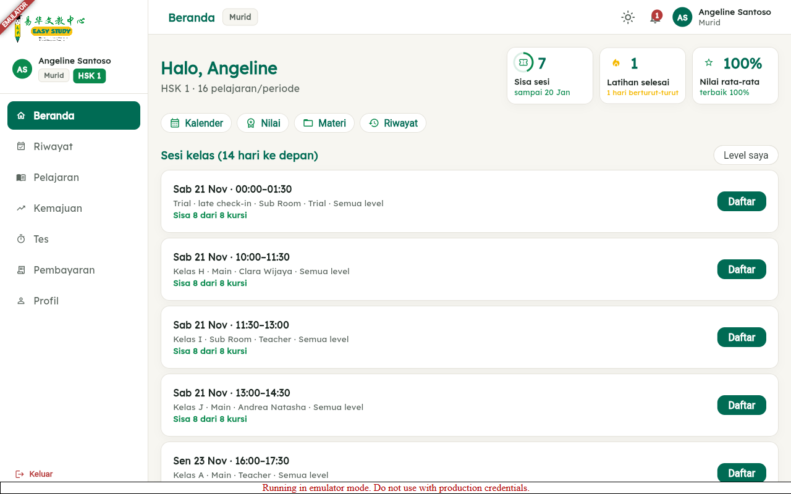

## 03_soal_latihan.png

MANUAL: sign in as student1, open a practice package, answer an R1 fill-in-the-blank question, submit, and capture the review with the pembahasan.

## 04_soal_typing.png

The typing package (pkg_typing)

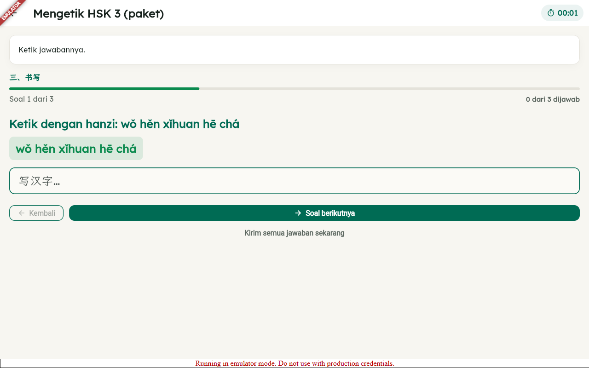

## 05_voucher.png

Student Payments tab: vouchers and Beli

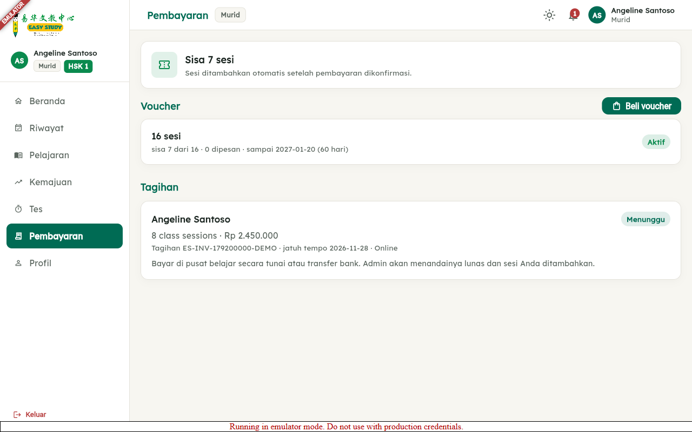

## 06_tes_token.png

Token input with the test code

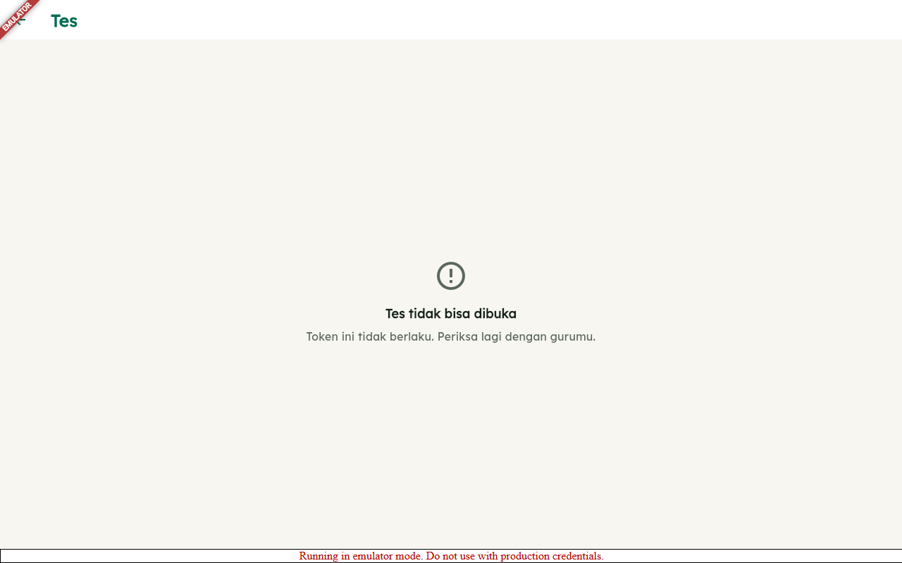

## 07_leaderboard.png

Leaderboard of H3DEMO1

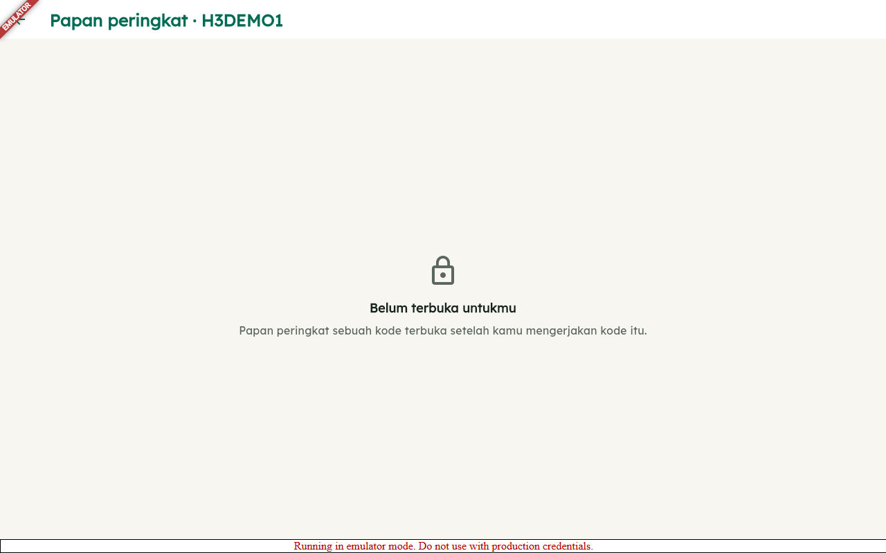

## 08_progress.png

Student Progress tab: the report

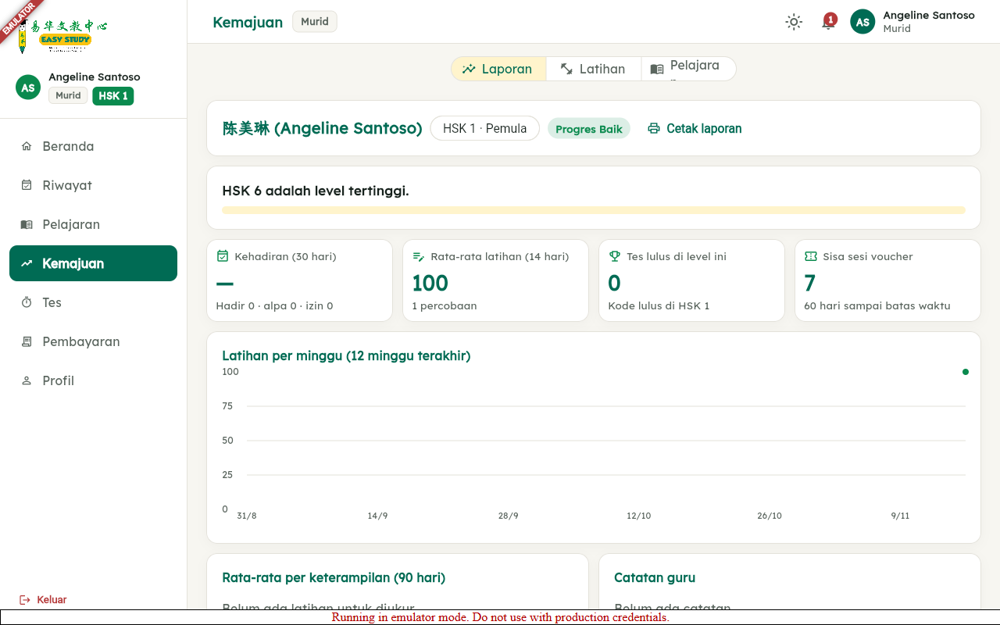

## 09_guru_jadwal.png

Teacher Schedule: Today

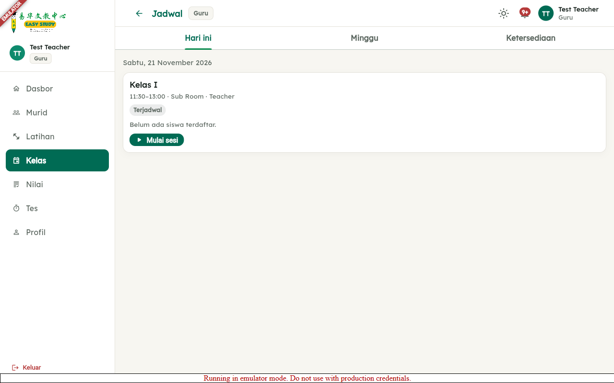

## 10_guru_pengawasan.png

Supervision of a fresh H3DEMO1 session: token and students

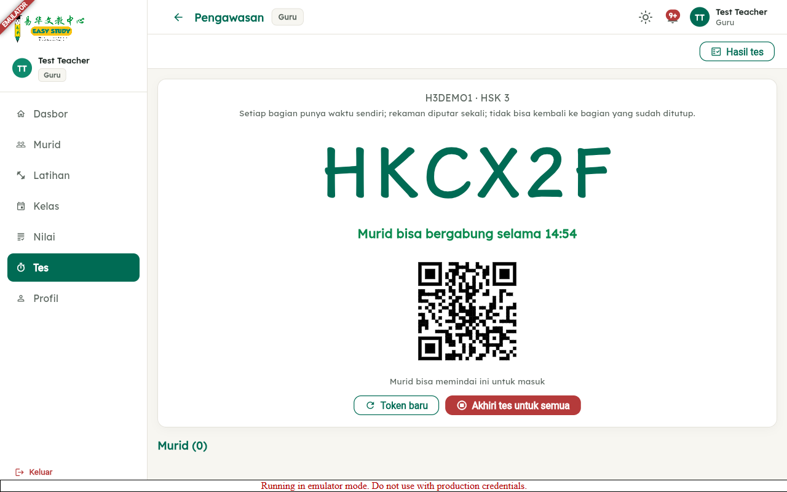

## 11_admin_buat_jadwal.png

MANUAL: sign in as admin, Kelas → Jadwal mingguan → Jadwal baru; pick Andrea, Monday 16:00, Main: the clash text and the suggested free times appear; capture the dialog.

## 12_admin_persetujuan.png

Registration approval (pending1@, pending2@)

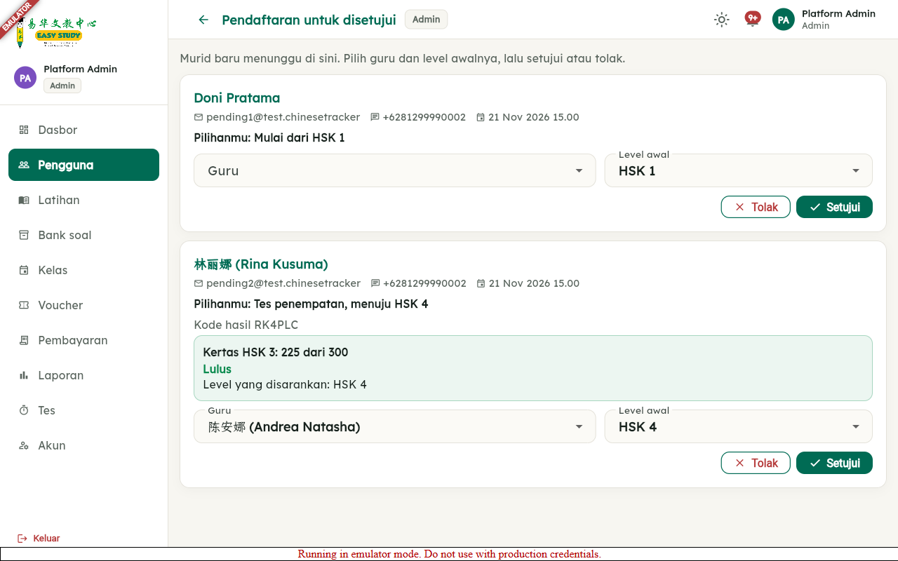

## 13_admin_kenaikan.png

Promotion verification

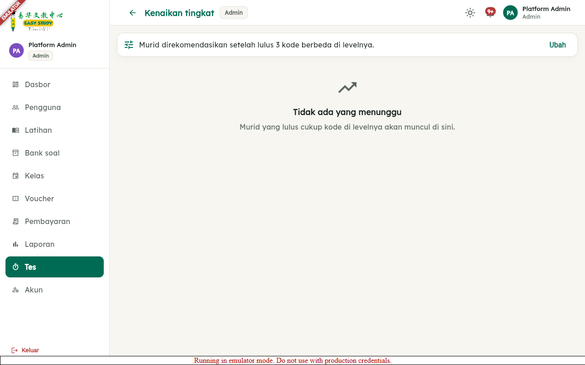

## 14_admin_dashboard.png

Admin dashboard: the six duty cards

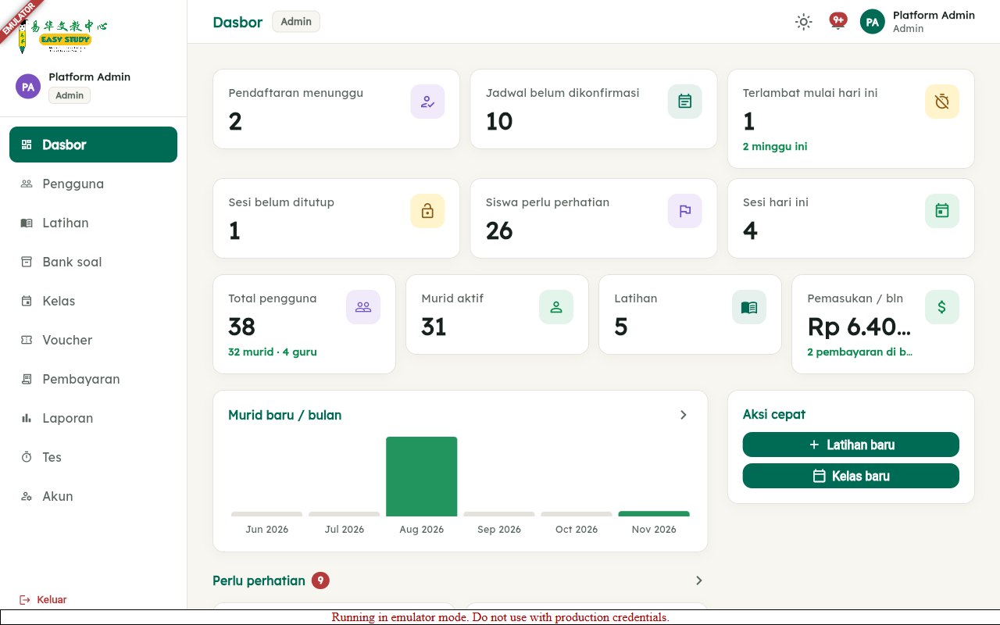

## 15_admin_pembayaran.png

Admin Payments: invoice list with status

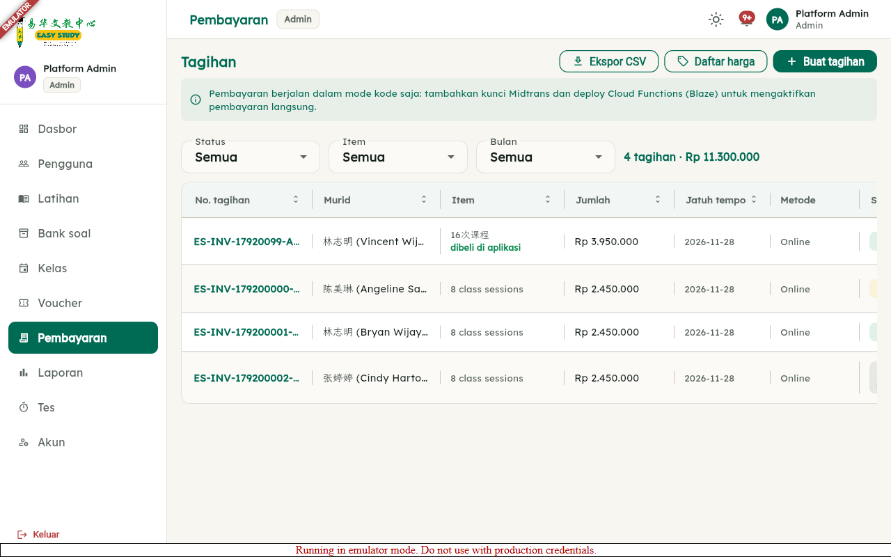
