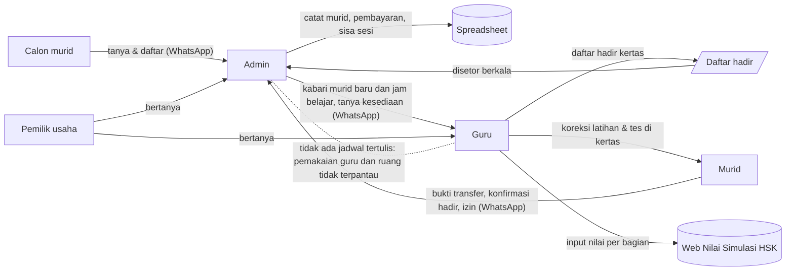
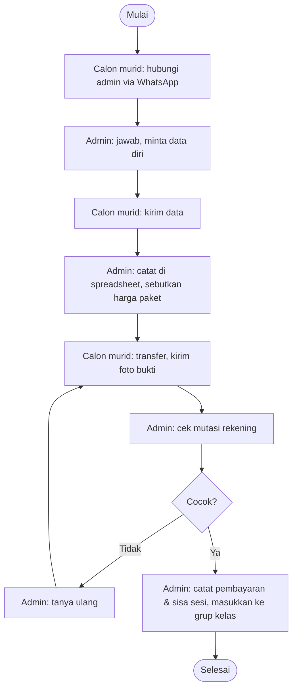
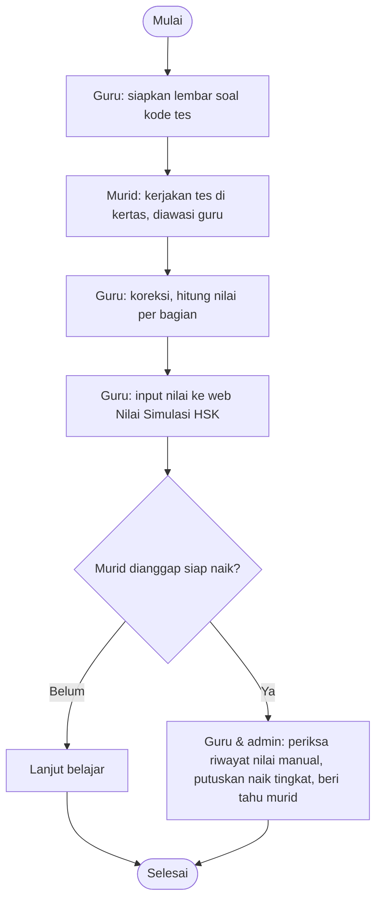

# BAB III
# PROSES BISNIS

Bab ini menjelaskan proses bisnis yang berjalan di Easy Study sebelum
aplikasi dibuat (sistem lama). Pemahaman atas sistem lama diperlukan untuk
melihat di mana letak masalahnya dan bagian mana yang diubah oleh sistem
baru. Bab ini berisi profil Easy Study, deskripsi proses yang berjalan,
pemodelan proses dalam bentuk rich picture, use case diagram, dan activity
diagram, serta permasalahan yang ditemukan.

## 3.1 Profil Easy Study

Easy Study (易华文教中心) adalah lembaga kursus bahasa Mandarin di
Surabaya yang berdiri sejak [ISI: tahun] dan beralamat di [ISI: alamat].
Easy Study mengajarkan bahasa Mandarin secara tatap muka dari tingkat
HSK 1 sampai HSK 6. Keenam tingkat dikelompokkan menjadi tiga level, yaitu
Beginner (HSK 1–2), Intermediate (HSK 3–4), dan Advance (HSK 5–6). Kelas
bersifat semi-privat dengan enam sampai delapan kursi per kelas dan
dilaksanakan di dua ruang, yaitu ruang utama dan ruang kecil.

Pada saat tugas akhir ini disusun, Easy Study dikelola oleh satu admin dan
empat guru. Profil guru dan level yang diajarkan ditunjukkan pada Tabel 3.1,
sedangkan sebaran murid aktif per level ditunjukkan pada Tabel 3.2. Dalam
satu bulan Easy Study rata-rata menerima [ISI: jumlah] pembayaran paket
kursus dan menyelenggarakan [ISI: jumlah] tes simulasi HSK.

Tabel 3.1
Guru Easy Study dan Level yang Diajarkan

| No | Guru | Level yang diajarkan | Hari mengajar |
|---|---|---|---|
| 1 | [ISI: inisial guru 1] | [ISI] | [ISI] |
| 2 | [ISI: inisial guru 2] | [ISI] | [ISI] |
| 3 | [ISI: inisial guru 3] | [ISI] | [ISI] |
| 4 | [ISI: inisial guru 4] | [ISI] | [ISI] |

Tabel 3.2
Sebaran Murid Aktif per Level

| Level | Tingkat | Jumlah murid aktif | Kelas per minggu |
|---|---|---|---|
| Beginner | HSK 1–2 | [ISI] | [ISI] |
| Intermediate | HSK 3–4 | [ISI] | [ISI] |
| Advance | HSK 5–6 | [ISI] | [ISI] |
| Total | | [ISI] | [ISI] |

Murid membeli paket kursus berupa sejumlah sesi (delapan atau enam
belas sesi) dengan masa berlaku tertentu, lalu mengikuti kelas pada hari dan
jam yang sudah ditentukan untuk levelnya. Guru pengajar setiap kelas
ditentukan oleh admin; murid tidak memilih guru. Selain kelas, Easy Study
menyelenggarakan tes simulasi HSK secara berkala untuk mengukur kesiapan
murid naik tingkat dan mengikuti ujian HSK resmi.

## 3.2 Deskripsi Sistem Saat Ini

Sebelum aplikasi dibuat, hampir seluruh proses di Easy Study dijalankan
secara manual dengan bantuan WhatsApp, spreadsheet, dan kertas. Proses
tersebut diuraikan per kegiatan berikut.

### 3.2.1 Pendaftaran Murid

Calon murid atau orang tuanya menghubungi admin melalui WhatsApp
untuk menanyakan kelas, biaya, dan jadwal. Admin menjawab satu per satu,
meminta data diri (nama, nama Mandarin, tanggal lahir, nomor telepon, dan
pengalaman belajar), lalu mencatatnya di spreadsheet daftar murid. Penentuan
tingkat awal dilakukan berdasarkan pengakuan calon murid atau tes singkat
yang diberikan guru secara lisan; tidak ada tes penempatan yang terstandar.
Setiap murid menyepakati hari les tertentu saat mendaftar, tetapi murid
bebas memilih sesi lain yang lebih cocok dengan kesibukannya. Caranya, sehari
sebelumnya admin mengirim daftar sesi ke grup WhatsApp siswa (misalnya Sesi 1
pukul 15.00–16.30 dan Sesi 2 pukul 16.30–18.00, masing-masing delapan
tempat), lalu murid menuliskan namanya pada sesi yang dipilih, seperti pada
Gambar 3.1. Tidak ada jadwal guru atau jadwal kelas yang tertulis selain
daftar harian tersebut. Jika seorang guru berhalangan, admin menghubungi guru
lain satu per satu melalui chat untuk mencari pengganti, lalu memberi tahu
murid yang terdaftar.

[GAMBAR 3.1: tangkapan layar daftar sesi harian di grup WhatsApp siswa, nama
dan nomor disamarkan]

Gambar 3.1
Daftar Sesi Harian di Grup WhatsApp Siswa pada Sistem Lama

### 3.2.2 Pembayaran dan Paket Sesi

Murid membayar paket kursus melalui transfer bank, lalu mengirim foto
bukti transfer melalui WhatsApp. Admin mencocokkan bukti tersebut dengan
mutasi rekening satu per satu dan mencatat pembayaran di spreadsheet. Sisa
sesi setiap murid dihitung secara manual dari daftar hadir: setiap kali murid
hadir, admin mengurangi satu sesi dari paketnya. Masa berlaku paket juga
dipantau secara manual, sehingga paket yang sudah lewat masa berlakunya
kadang baru diketahui belakangan.

### 3.2.3 Kehadiran

Guru mencatat kehadiran murid pada daftar hadir kertas di setiap
pertemuan, seperti pada Gambar 3.2: nama murid, jam masuk, dan lama belajar
(1,5 jam untuk satu sesi atau 3 jam untuk dua sesi berturut-turut), satu
blok per hari. Daftar hadir tersebut dikumpulkan ke
admin secara berkala untuk diperiksa dan dipakai sebagai dasar pengurangan
sisa sesi. Murid yang izin sebelum kelas dimulai tidak dipotong sesinya,
sedangkan murid yang tidak hadir tanpa kabar (alpa) tetap dipotong satu
sesi. Karena pencatatan dan pengurangan dilakukan terpisah dan manual,
selisih antara sisa sesi menurut admin dan menurut murid kadang terjadi.

[GAMBAR 3.2: foto daftar hadir kertas]

Gambar 3.2
Daftar Hadir Kertas pada Sistem Lama

### 3.2.4 Latihan dan Tes Simulasi HSK

Soal latihan dibagikan dalam bentuk kertas atau fotokopi dan dikoreksi
manual oleh guru. Tes simulasi HSK dikerjakan di atas kertas di Easy Study
dengan pengawasan guru. Setelah dikoreksi, nilai per bagian (mendengarkan,
membaca, dan menulis) dimasukkan satu per satu ke aplikasi web Nilai
Simulasi HSK, seperti pada Gambar 3.3. Aplikasi web tersebut hanya
menyimpan nilai dan terpisah dari data murid lainnya (pendaftaran, kehadiran,
dan paket). Setiap paket tes simulasi diberi kode tes, misalnya H3216917Z
untuk tes HSK 3, dan setiap kode berisi soal yang berbeda. Kenaikan tingkat
diputuskan dengan memeriksa riwayat nilai simulasi secara manual.

[GAMBAR 3.3: tangkapan layar aplikasi web Nilai Simulasi HSK]

Gambar 3.3
Aplikasi Web Nilai Simulasi HSK pada Sistem Lama

### 3.2.5 Pemantauan Perkembangan Murid

Perkembangan belajar murid tidak terdokumentasi secara terpusat. Catatan
tentang kemampuan murid ada pada masing-masing guru, nilai simulasi ada di
aplikasi web terpisah, kehadiran ada di kertas, dan sisa paket ada di
spreadsheet. Pemilik usaha harus bertanya kepada setiap guru untuk
mengetahui kemampuan seorang murid, dan orang tua murid hanya menerima
kabar jika bertanya. Rekap bulanan tentang murid baru, pendapatan, dan jam
mengajar guru dibuat secara manual pada akhir bulan.

## 3.3 Pemodelan Sistem Saat Ini

Proses pada sistem lama dimodelkan dalam tiga bentuk, yaitu rich picture
untuk menggambarkan seluruh pihak dan aliran informasi secara utuh, use case
diagram untuk menggambarkan kegiatan setiap pihak, dan activity diagram
untuk menggambarkan urutan langkah pada proses-proses utama.

### 3.3.1 Rich Picture

Rich picture sistem lama ditunjukkan pada Gambar 3.4. Terdapat lima
pihak yang terlibat, yaitu calon murid, murid, admin, guru, dan pemilik usaha,
serta empat alat bantu, yaitu WhatsApp, spreadsheet, daftar hadir kertas, dan
aplikasi web Nilai Simulasi HSK. Hampir semua aliran informasi melewati
admin: pendaftaran, pertanyaan jam belajar, bukti transfer, konfirmasi kehadiran,
dan permintaan guru pengganti datang kepada admin melalui WhatsApp, lalu
admin mencatatnya di spreadsheet. Guru menerima kabar murid baru beserta
jam belajarnya dari admin, mencatat kehadiran di kertas, mengoreksi latihan dan tes di kertas, lalu
menyetorkan daftar hadir dan nilai kepada admin. Pemilik usaha memperoleh
gambaran keadaan kursus dengan bertanya kepada admin dan guru.

[GAMBAR 3.4: rich picture sistem lama]

Gambar 3.4
Rich Picture Sistem Saat Ini



### 3.3.2 Use Case Diagram Sistem Saat Ini

Use case diagram sistem lama ditunjukkan pada Gambar 3.5. Aktor calon
murid mendaftar melalui WhatsApp. Aktor murid mengonfirmasi kehadiran,
mengirim bukti transfer, mengerjakan latihan dan tes di kertas, dan
menanyakan sisa sesi. Aktor guru memberi tahu ketersediaan, mencatat
kehadiran, mengoreksi latihan dan tes, dan memasukkan nilai simulasi ke
aplikasi web. Aktor admin mencatat pendaftaran, menyepakati jam belajar, mencari
guru pengganti, mencocokkan pembayaran, menghitung sisa sesi, dan
membuat rekap bulanan. Aktor pemilik usaha membaca rekap dan menanyakan
perkembangan murid. Semua use case tersebut dilakukan tanpa sistem yang
terhubung.

[GAMBAR 3.5: use case diagram sistem lama]

Gambar 3.5
Use Case Diagram Sistem Saat Ini

```mermaid
%% Alat bantu menggambar Gambar 3.5 (bukan isi buku)
flowchart LR
  subgraph Sistem lama (manual)
    U1([Mendaftar lewat WhatsApp])
    U2([Konfirmasi hadir / izin])
    U3([Kirim bukti transfer])
    U4([Kerjakan latihan & tes di kertas])
    U5([Tanya sisa sesi])
    U6([Beri tahu ketersediaan])
    U7([Catat kehadiran di kertas])
    U8([Koreksi latihan & tes])
    U9([Input nilai simulasi ke web])
    U10([Catat pendaftaran di spreadsheet])
    U11([Sepakati jam belajar lewat chat])
    U12([Cari guru pengganti])
    U13([Cocokkan bukti transfer])
    U14([Hitung sisa sesi manual])
    U15([Buat rekap bulanan])
    U16([Tanya perkembangan murid])
  end
  CM[Calon murid] --> U1
  M[Murid] --> U2 & U3 & U4 & U5
  G[Guru] --> U6 & U7 & U8 & U9
  A[Admin] --> U10 & U11 & U12 & U13 & U14 & U15
  P[Pemilik usaha] --> U15 & U16
```

### 3.3.3 Activity Diagram Sistem Saat Ini

Dua proses utama sistem lama digambarkan dalam activity diagram, yaitu
pendaftaran dan pembayaran serta tes simulasi dan kenaikan tingkat.

Gambar 3.6 menggambarkan pendaftaran dan pembayaran. Calon murid
menghubungi admin melalui WhatsApp, admin menjawab dan meminta data,
lalu mencatat data di spreadsheet. Admin menyebutkan harga paket, murid
mentransfer dan mengirim foto bukti, admin memeriksa mutasi rekening; jika
cocok, admin mencatat pembayaran dan memasukkan murid ke grup kelas,
jika tidak cocok admin menanyakan ulang kepada murid.

[GAMBAR 3.6: activity diagram pendaftaran dan pembayaran pada sistem lama]

Gambar 3.6
Activity Diagram Pendaftaran dan Pembayaran pada Sistem Saat Ini



Gambar 3.7 menggambarkan tes simulasi dan kenaikan tingkat. Guru
menyiapkan lembar soal dan mengawasi tes di kelas, murid mengerjakan di
kertas, guru mengoreksi dan menghitung nilai per bagian, lalu memasukkan
nilai ke aplikasi web Nilai Simulasi HSK. Ketika guru menilai murid sudah
siap, guru dan admin memeriksa riwayat nilai simulasi secara manual dan
memutuskan kenaikan tingkat, lalu memberi tahu murid.

[GAMBAR 3.7: activity diagram tes simulasi dan kenaikan tingkat pada sistem lama]

Gambar 3.7
Activity Diagram Tes Simulasi dan Kenaikan Tingkat pada Sistem Saat Ini



## 3.4 Permasalahan pada Sistem Saat Ini

Berdasarkan uraian dan pemodelan di atas, permasalahan utama sistem lama
dirangkum pada Tabel 3.3 beserta penyebab dan akibatnya. Permasalahan
tersebut menjadi dasar analisis kebutuhan pada Bab IV dan dijawab oleh
rancangan sistem baru pada Bab V.

Tabel 3.3
Permasalahan pada Sistem Saat Ini

| No | Masalah | Penyebab | Akibat |
|---|---|---|---|
| 1 | Tidak ada jadwal guru dan kelas | Jam belajar disepakati lewat chat tanpa jadwal tertulis; pemakaian guru dan ruang tidak tercatat di mana pun | Admin dan pemilik tidak tahu kapan guru dan ruang terpakai; setiap perubahan jam diatur ulang satu per satu lewat chat |
| 2 | Guru pengganti sulit dicari | Tidak ada data ketersediaan dan level yang diajar tiap guru dalam satu tempat | Admin menghubungi guru satu per satu; murid terlambat diberi tahu |
| 3 | Data murid tersebar | Pendaftaran di chat dan spreadsheet, kehadiran di kertas, nilai di aplikasi web terpisah | Data sulit dicari dan tidak sinkron antarsumber |
| 4 | Selisih sisa sesi paket | Sisa sesi dihitung manual dari daftar hadir kertas; izin dan alpa diperlakukan berbeda tanpa catatan yang seragam | Perselisihan sisa sesi antara admin dan murid; paket kedaluwarsa tidak terpantau |
| 5 | Pemeriksaan pembayaran memakan waktu | Bukti transfer dicocokkan dengan mutasi rekening satu per satu | Waktu admin habis untuk pekerjaan berulang; pembayaran yang belum dicek menunda masuk kelas |
| 6 | Koreksi latihan dan tes lambat | Latihan dan tes di kertas, dikoreksi manual, nilai diketik ulang | Umpan balik ke murid terlambat; kesalahan ketik nilai |
| 7 | Kenaikan tingkat tidak terstandar | Riwayat nilai diperiksa manual; tidak ada aturan tertulis jumlah tes yang harus lulus | Keputusan naik tingkat berbeda antarguru; murid tidak tahu syaratnya |
| 8 | Perkembangan murid sulit dipantau | Catatan ada pada masing-masing guru; tidak ada ringkasan per murid | Pemilik usaha dan orang tua tidak punya gambaran; murid yang tertinggal terlambat ditangani |
| 9 | Rekap bisnis manual | Murid baru, pendapatan, dan jam mengajar direkap di akhir bulan dari beberapa sumber | Rekap terlambat dan rawan salah |

Kesembilan masalah tersebut bermuara pada tiga hal: data yang tersebar,
pekerjaan berulang yang dilakukan manual oleh admin, dan tidak adanya
gambaran perkembangan murid yang dapat dipantau. Sistem baru yang
dirancang pada bab berikutnya memindahkan seluruh proses tersebut ke dalam
satu aplikasi dengan basis data terpusat dan logika penting yang dijalankan di
server.
